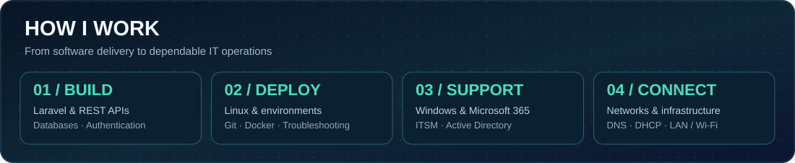
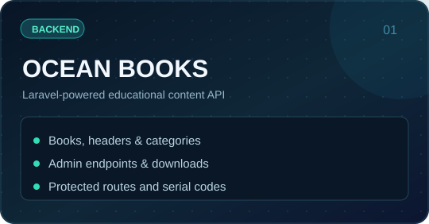
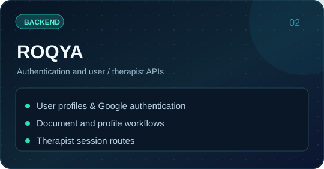
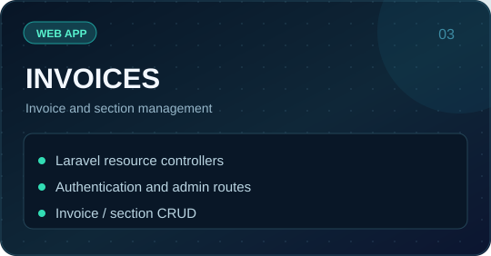
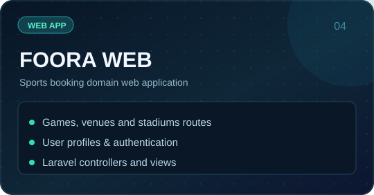
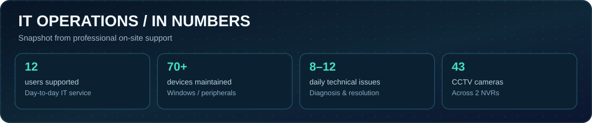
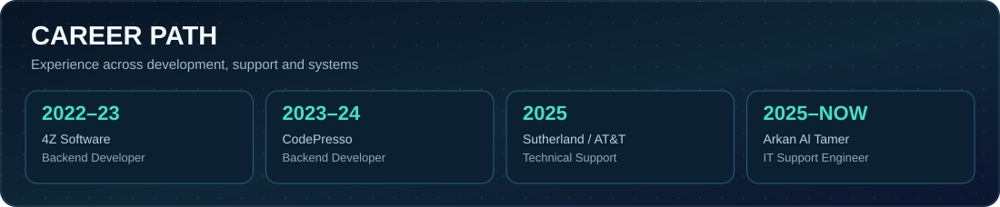
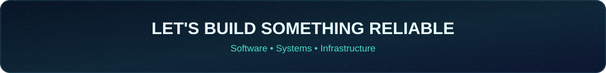

<!-- النسخة العربية من ملف التعريف لحساب almoatasembellah -->

<a href="README.md">🇬🇧 English</a> · <b>🇪🇬 العربية</b>

  
  
  

## 👋 نبذة عني

أنا **مطور Backend ومهندس دعم فني**، ولدي خبرة في تطوير التطبيقات باستخدام **PHP وLaravel وREST APIs وMySQL**، إلى جانب التعامل مع بيئات **Windows وMicrosoft 365 وActive Directory والشبكات المحلية**.

أهتم ببناء أنظمة مفيدة، وتشخيص المشكلات التقنية بدقة، وتوثيق الحلول، وتحسين استقرار الخدمات التي يعتمد عليها المستخدمون يوميًا.

- **تطوير البرمجيات:** Laravel، واجهات REST API، قواعد البيانات، المصادقة وتطوير التطبيقات.
- **الدعم الفني:** Windows 10/11، Microsoft 365، إدارة حسابات المستخدمين، الأجهزة، البلاغات والتصعيد.
- **الشبكات والبنية التحتية:** LAN/Wi-Fi، TCP/IP، DNS/DHCP، أساسيات VLAN، VMware وكاميرات المراقبة الشبكية.
- **التعليم:** بكالوريوس علوم الحاسب — 2023.

## 🚀 مشروعات مختارة

  
  

  
  

[صفحة بنك — Frontend](https://github.com/almoatasembellah/Bank-landing-page.frontend) · [واجهة متجر](https://github.com/almoatasembellah/a-product-store) · [كل المستودعات](https://github.com/almoatasembellah?tab=repositories)

## 🛠️ التقنيات والأدوات

**الأنظمة:** Windows، Microsoft 365، Active Directory، VMware، الشبكات المحلية، DNS، DHCP، وأنظمة ITSM.

Windows Server/GPO وبعض خدمات AWS ضمن الدراسة والتطبيقات المعملية، وليست شهادات احترافية.

## 📡 أرقام من عملي بالدعم الفني

## 🧭 الخبرة المهنية

## 📊 نشاط GitHub

<a href="https://www.linkedin.com/in/al-mutasim-bellah-yasser/">LinkedIn</a> · <a href="mailto:mbellah82@gmail.com">Email</a> · <a href="https://github.com/almoatasembellah">GitHub</a>
