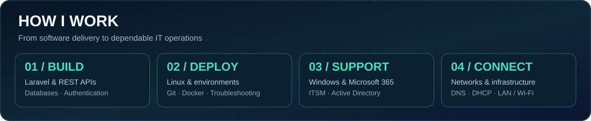
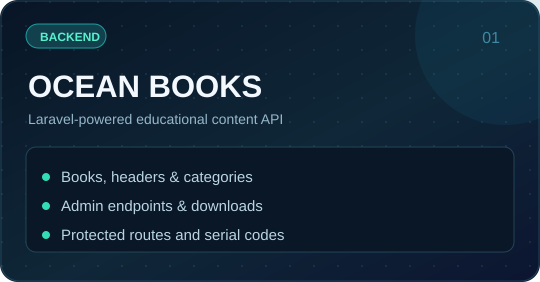
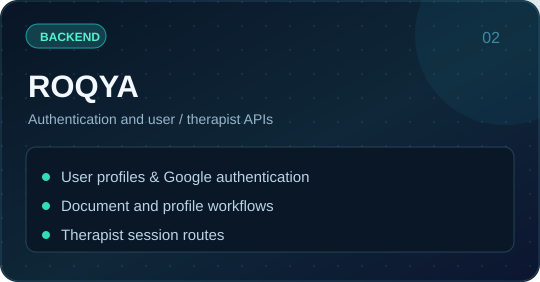
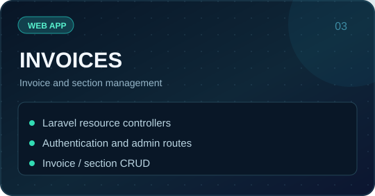
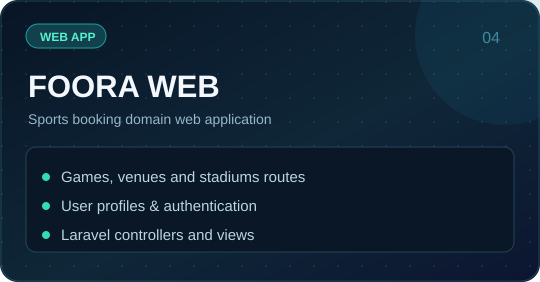
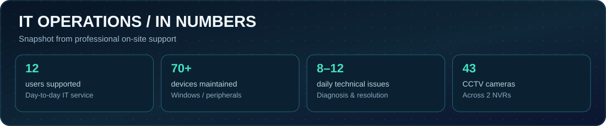
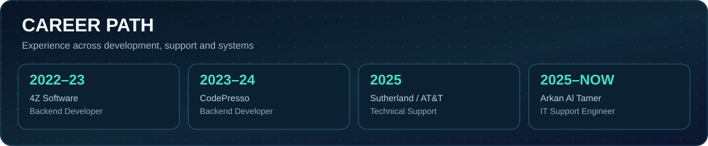
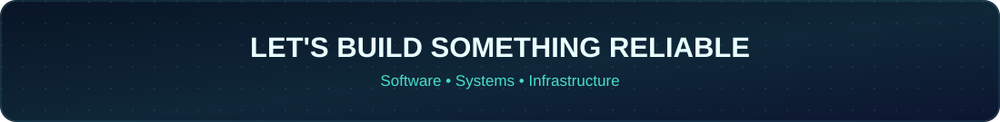

<!--
  GitHub profile README for github.com/almoatasembellah.
  Original SVG artwork is stored in ./assets and can be regenerated with:
      python scripts/generate_assets.py
  Please publish this README in the PUBLIC repository:
      https://github.com/almoatasembellah/almoatasembellah
-->

<b>🇬🇧 English</b> · <a href="README.ar.md">🇪🇬 العربية</a>

  

  

  
  
  

<b>Backend development × practical IT operations</b> · Based in Cairo, Egypt 🇪🇬

## 👋 About Me

I'm a **backend developer and IT support engineer** with experience across application development, Windows environments and network troubleshooting. I enjoy building useful systems—and keeping the infrastructure people depend on reliable.

- 💻 **Software:** PHP / Laravel, REST APIs, MySQL, authentication, application workflows and deployments.
- 🖥️ **IT operations:** Windows 10/11, Microsoft 365, Active Directory, hardware and software support, ticketing and escalations.
- 🌐 **Infrastructure:** LAN/Wi-Fi, TCP/IP, DNS/DHCP, VLAN fundamentals, VMware and CCTV/IP-camera environments.
- 🔎 **Approach:** Diagnose carefully, document clearly, solve the root problem and improve the next iteration.
- 🎓 **Background:** B.Sc. Computer Science (2023). Previously built Laravel backends at 4Z Software and CodePresso; now supporting users and IT systems at Arkan Al Tamer.

  

## 🚀 Selected Projects

A selection of repositories from my GitHub. The illustrations link directly to the source code.

  
  

  
  

**More frontend and experiments:** [Bank Landing Page](https://github.com/almoatasembellah/Bank-landing-page.frontend) · [Product Store UI](https://github.com/almoatasembellah/a-product-store) · [Explore all repositories](https://github.com/almoatasembellah?tab=repositories)

## 🛠️ Tech Stack & Tools

**Backend, frontend and development tools**

  

**Systems, networks and service delivery**

  
  
  
  
  
  
  

Professional hands-on experience and lab learning are different: Windows Server/GPO and AWS networking services are part of my technical lab practice.

## 📡 IT Operations Snapshot

My current support work covers Windows endpoints, Microsoft 365, user permissions, local networks and CCTV devices. These are **workplace support figures**, not GitHub contribution counts.

  

## 🧭 Experience Timeline

  

## 📊 GitHub Activity

  

  
  

Activity cards use a third-party GitHub visualization service and may occasionally be unavailable or delayed.

  
  

<i>Interested in practical backend projects, IT operations and infrastructure problem-solving.</i>
